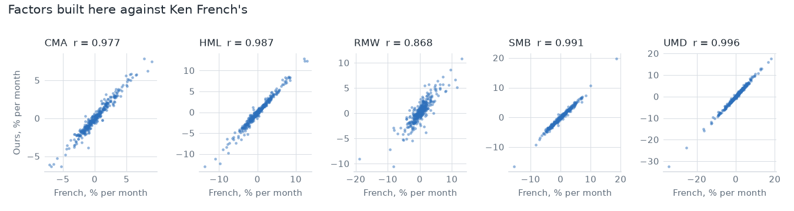
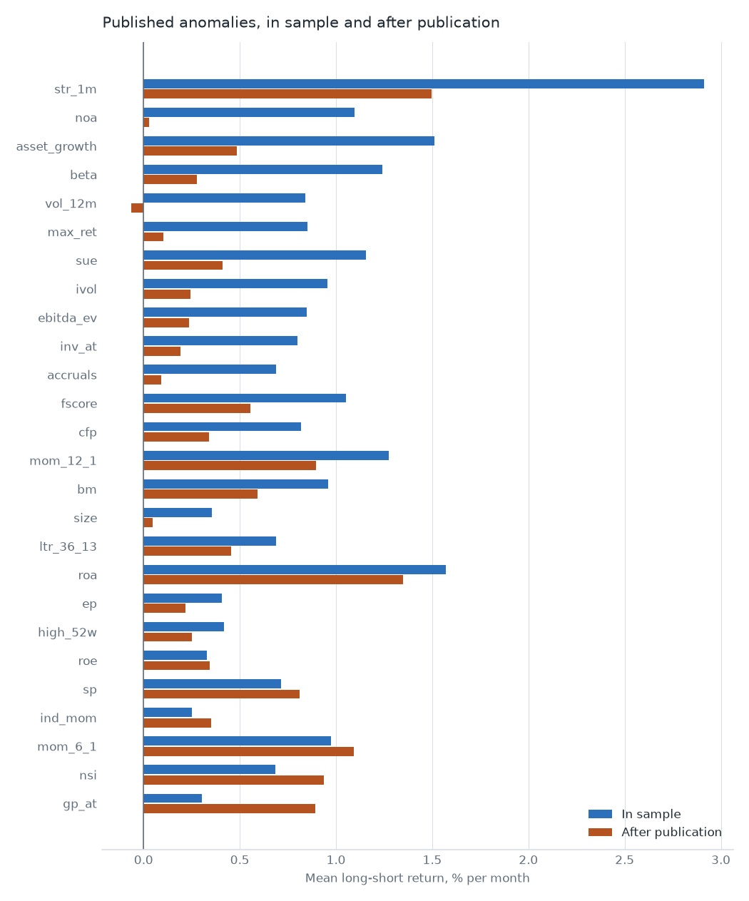
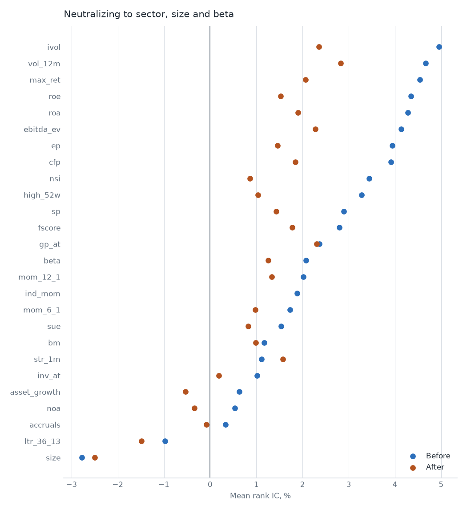
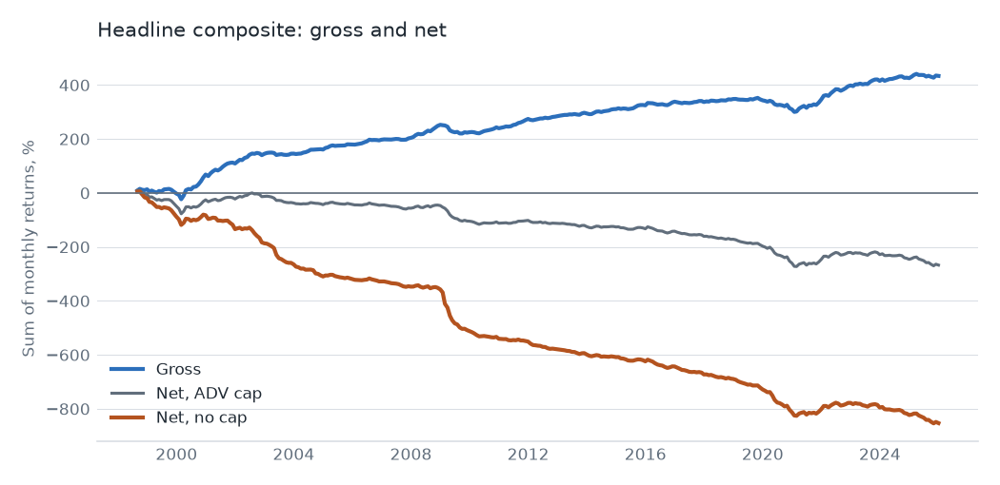
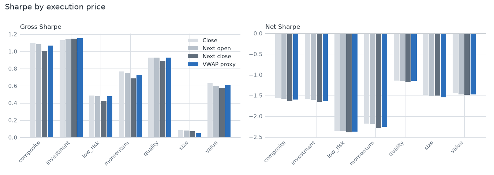
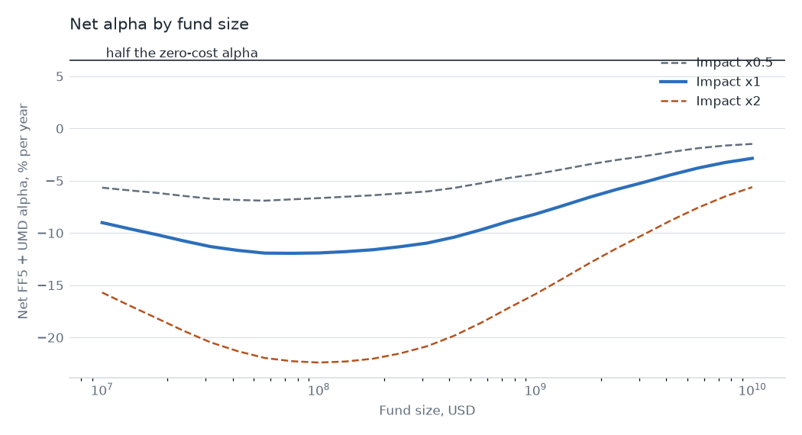
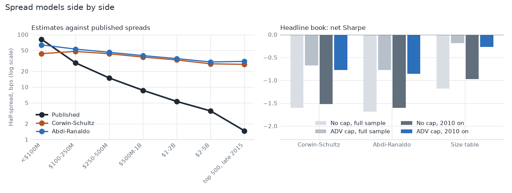

# Cross-sectional equity factor research pipeline

> Point-in-time data, a library of factors, and the evaluation stack a systematic equity desk uses every day.

**Bottom line:** a composite of 26 published signals earns a real gross return, with FF5 + UMD alpha of 14.3% a year (t 7.7). As a monthly equal-weight decile book it doesn't survive its costs: at $100M the net Sharpe is -1.60 with no trade cap and -0.68 with one, on the Corwin-Schultz spreads D-06 set for the headline. Those spreads turned out to be far too high, so after that failure the book was rerun on other spread models. Better spreads don't rescue it: on published spreads the net Sharpe is -1.18 and -0.19, because market impact is the larger cost. The best case found, the top 1,000 on published spreads, is about zero.

This README is rendered by `efp report`. Every number comes from [results/readme_numbers.json](results/readme_numbers.json), and a test fails the build if one doesn't. Family memos are in [reports/memos](reports/memos).

## Hypothesis

Published equity anomalies should still add up to something tradable once you measure them without look-ahead, include dead companies and charge realistic costs. The project tests that in three steps: rebuild the data so nothing leaks, confirm the signals match published work, then ask what survives trading.

## Data

- **Prices and fundamentals:** Sharadar (`SEP`, `SF1`, `ACTIONS`, `TICKERS`), 1998 to 2025, including delisted names.
- **Filing times:** SEC EDGAR acceptance timestamps. 87.6% of fundamentals rows link to an acceptance time; the rest use the filing date plus one session, which is never earlier.
- **Point in time:** a fundamental is visible from the close of the session after acceptance. Signal code reads only through a gate that refuses later rows and all labels.
- **Delistings:** missing delisting returns are imputed at -30% on NYSE and AMEX and -55% on NASDAQ for performance failures, following Shumway.
- **Benchmarks:** Ken French factors and Open Source Asset Pricing (OSAP) series.

Raw data stays in a git-ignored folder. Only aggregate tables and figures are published, and return series aren't. See [docs/data.md](docs/data.md) and [docs/pit.md](docs/pit.md).

## Method

- **Universe:** top 3,000 US common stocks by market cap, rebuilt monthly, priced above $1.
- **Signals:** 26 across value, momentum, quality, investment, low risk and size, winsorized and z-scored each month. Each runs with and without neutralization to FF-49 sector, size and beta.
- **Evaluation:** rank IC, decile spreads, Fama-MacBeth, turnover and decay, with Newey-West errors.
- **Combination:** equal weight; IC-weighted on a trailing 36 months; ridge on an expanding window of at least 120 months. All walk-forward, with a 1-month purge.
- **Headline book:** equal weight of neutralized scores, chosen before the first backtest ran. Dollar neutral, gross leverage 2.0, rebalanced monthly into equal-weight deciles.
- **Costs:** Corwin-Schultz half-spread with a 2 bp floor, square-root impact with coefficient 1.0 on 20-day ADV, and borrow of 0.25% for the top 500, 1.0% to rank 1,000 and 5.0% beyond. These are modelling assumptions, not measurements. Two other spread models were run later; see [below](#other-spread-models-run-after-the-failure).

Details are in [docs/methods.md](docs/methods.md) and [docs/signals.md](docs/signals.md).

## Results

### The data is right

Our factors against Ken French's:

| Factor | Correlation |
|---|---|
| UMD | 0.996 |
| SMB | 0.991 |
| HML | 0.987 |
| CMA | 0.977 |
| RMW | 0.868 |

Dropping delisted names would have added 4.4% a year to the equal-weight universe, raising it from 9.4% to 13.7% and its Sharpe from 0.46 to 0.72.



### Published anomalies replicate, and they decay

22 of 26 signals correlate at 0.70 or more with OSAP's published series with the same sign, over 301 to 334 months. The bar was 20.

On OSAP's series, pooled returns fall 30% out of sample (t -1.0) and 39% after publication (t -2.1). McLean and Pontiff (2016) report 26% and 58% across 97 anomalies, so the direction agrees and the post-publication decline here is smaller. Our own Sharadar series can't test this: the data starts in 1998, so only 9 signals have enough in-sample months.



### Significance

All 517 logged trials are judged against t > 3.0 (Harvey, Liu and Zhu, 2016) and BHY-adjusted p-values. 35 trials clear t = 3.0 with a positive sign, and 35 survive BHY at 5%. Many of those are the same composites gross. The hurdle is two-sided, so the net rows that also clear it do so because they lose money significantly.

Neutralizing to sector, size and beta usually shrinks an IC without killing it:



### The composite

Headline: equal weight, neutralized, top 3,000, next-day VWAP proxy, $100M.

| | Gross | Net, no cap | Net, 10% ADV cap |
|---|---|---|---|
| Mean per year | 15.8% | -31.1% | -9.8% |
| Sharpe | 1.07 | -1.60 | -0.68 |
| FF5 + UMD alpha | 14.3% (t 7.7) | -33.0% (t -7.0) | -10.6% (t -5.3) |

Gross loadings are RMW 0.67, HML 0.33, UMD 0.11 and market -0.18, with R-squared of 0.59. The six factors explain over half the variance, and a large alpha remains.

Costs are 46.9% a year: 32.0% impact, 11.1% spread and 3.8% borrow, on 39% of the book replaced each month.



Other methods, gross Sharpe then net with no cap: IC-weighted 0.78, -1.89; ridge 1.19, -1.91. Fitting weights didn't help after costs.

Execution price barely matters next to costs. The composite's gross Sharpe is 1.10 at the close and 1.07 at the next-day VWAP proxy.



### Costs and capacity

D-06's sensitivity scales every cost together:

| Costs | Net Sharpe, no cap | Net Sharpe, ADV cap |
|---|---|---|
| x0.5 | -0.47 | 0.11 |
| x1 | -1.60 | -0.68 |
| x2 | -2.78 | -2.16 |

Capacity is the fund size where net alpha is 50% of zero-cost alpha, here 7.1%. **Under Corwin-Schultz, no fund size from $10M to $10B reaches it:** at $10M net alpha is already -7.5%, because spread and borrow don't shrink with size. Past about $100M net alpha rises again only because the ADV cap freezes the book; that isn't capacity.

The top 1,000, added afterwards as a labelled sensitivity, gives alpha of 8.5% (t 4.0), net Sharpe -0.63, and the same capacity outcome.



### Other spread models, run after the failure

These runs came after the Corwin-Schultz result failed, at the owner's request, so treat them as a follow-up and not as a test. Corwin-Schultz stays the headline, and every run is in the trial log. The reading rule was set before they ran: a model's net result counts only as far as its estimates match published spreads for the same stocks.

**Abdi-Ranaldo** uses daily close, high and low prices. **The size table** isn't an estimator: it's published effective spreads by market cap, from an SEC staff study of 2013 up to $5B and Hagströmer's S&P 500 sample of 2015 above that. The spec names the option but gives no values, so these were sourced before any result used them.

Mean half-spread in bps against those published figures:

| Stocks | Published | Corwin-Schultz | Abdi-Ranaldo |
|---|---|---|---|
| Top 500, late 2015 | 1.47 | 27.2 | 30.9 |
| $2-5B, 2013 | 3.5 | 27.8 | 30.1 |
| $500M-1B, 2013 | 8.7 | 37.4 | 39.8 |
| $100-250M, 2013 | 29.1 | 47.9 | 53.0 |
| Under $100M, 2013 | 81.5 | 43.5 | 63.8 |

Both daily-range estimators read far too high outside the smallest stocks: 18.5x and 21.0x on large caps. Abdi-Ranaldo is no improvement here, so under the rule neither net result says much about true costs. The size table matches because it is those figures, so that isn't independent evidence. Its figures describe the 2010s and it applies them to every year, which understates earlier spreads, so results are also cut from 2010.

Net Sharpe at $100M, next-day VWAP proxy, with capacity at impact x1:

| Book and spreads | No cap | ADV cap | ADV cap, 2010 on | Capacity |
|---|---|---|---|---|
| Top 3,000, Corwin-Schultz | -1.60 | -0.68 | -0.77 | below the grid |
| Top 3,000, Abdi-Ranaldo | -1.68 | -0.77 | -0.86 | below the grid |
| Top 3,000, size table | -1.18 | -0.19 | -0.27 | below the grid |
| Top 1,000, Corwin-Schultz | -0.63 | -0.50 | -0.60 | below the grid |
| Top 1,000, Abdi-Ranaldo | -0.77 | -0.64 | -0.72 | below the grid |
| Top 1,000, size table | -0.05 | 0.07 | -0.10 | about $20M |



What this supports:

- **Corwin-Schultz overstated spreads, and that mattered.** Published spreads cut the headline book's spread cost from 11.1% to 2.5% a year.
- **It isn't why the book fails.** Impact is 32.0% a year either way. With the published table the top 3,000 still nets -22.5% uncapped and -2.7% capped.
- **The best case is about zero, not positive.** The top 1,000 on the size table nets -0.5% uncapped and 0.8% capped, with capped alpha of 1.1% (t 0.6). It's negative from 2010 on, at -1.1%, and it's the best of 3 models across 8 books, picked after the fact.
- **Capacity exists only in that cell, and it's small:** about $20M at impact x1, about $89M at x0.5 and below the grid at x2.
- **Impact is now the assumption to question.** It's the largest cost in the headline book under every model, and unlike spreads it hasn't been checked against published data. These runs don't test it.

### How many tries

The headline rests on 517 logged trials: 86 replication, 209 composite, 40 value, 66 momentum, 44 quality, 32 investment, 32 low risk and 8 size. 26 were run from a dirty tree and are kept. 32 of the composite rows are the later spread-model runs, marked in `x_note`. `efp explog export` hands the log to the sibling backtest-overfitting-lab repo.

## What failed

- **The headline hypothesis.** The composite doesn't pay for itself as specified, at any size tested.
- **4 replications** fall short: `sue` r 0.69, `noa` r 0.46, `accruals` r 0.39, `fscore` r 0.22. Each is listed with its likely cause in the table. Tuning stopped there.
- **Capacity has almost no dollar answer.** The book fails the test at the bottom of the grid in all but one cell, and that cell is the size table on the top 1,000, at about $20M.
- **Our own decay test** is too short to say anything.
- **Abdi-Ranaldo** didn't improve on Corwin-Schultz against published spreads for these stocks.
- **Neutralized `ind_mom`** was noise for two milestones before a table moved and gave it away. It's one number per industry, so sector dummies span it. It's now left out, and the old trial rows stay in the log.

## Limitations

- **The spread estimates are poor.** Corwin-Schultz reads 27.2 bps on large caps against a published 1.47, and Abdi-Ranaldo is no closer. The headline keeps Corwin-Schultz because D-06 set it, so its net figures overstate spread cost.
- **The size table is a snapshot.** It holds 2013 and 2015 figures in fixed dollar bands, which understates spreads in earlier years and ignores price.
- **Impact is unverified.** It's the largest cost in the headline book, and none of this tests the coefficient of 1.0. A better execution model could change the net result, and that hasn't been measured.
- **The book is deliberately naive.** Monthly rebalancing to equal weight has no turnover control. A desk would trade less.
- **Uncapped and capped are both flawed.** Uncapped positions reach 3.7x ADV. Capped books miss trades and drift, with net exposure up to 0.38 of NAV.
- **Restatements and items.** Sharadar's `AR*` dimensions are as-reported, but it lacks gross PP&E, taxes payable, deferred taxes and preferred stock. Book equity is plain `equity`.
- **VWAP proxy.** There is no intraday data, so it's (O+H+L+C)/4 of the next session.
- **Borrow is assumed,** not measured, and the flat top rate is likely too low for hard-to-borrow shorts.
- **Free path.** The EDGAR and Stooq route is survivorship-limited and watermarked; no headline result uses it.

## How to reproduce

Anyone, no data needed:

```bash
uv run efp synth generate --out data/raw/synthetic --seed 7
```

```bash
uv run efp rebuild --config configs/synthetic.yaml
```

With licensed snapshots in `data/raw/`:

```bash
uv run efp rebuild --config configs/headline.yaml
```

`efp rebuild` runs every stage through a content-addressed cache and rewrites every table, figure, memo and this README.

## Questions this project must answer

**How do you know a fundamental value was public on that date?** Each value carries the SEC's acceptance timestamp, and it's visible only from the close of the next session. A gate enforces that for every read, and a CI test corrupts all later data and requires signal values to stay bit-identical.

**Why does your value factor differ from Fama-French's?** Construction. Correlation with HML is 0.99 under Fama-French's rules, 0.82 once re-formed monthly, 0.65 on deciles and 0.29 neutralized. See `results/tables/value_gap_decomposition.csv`.

**What happens to Sharpe at next-day VWAP instead of the close?** Very little gross: 1.10 to 1.07. Net of costs it goes from -1.56 to -1.60.

**Would a better spread model have saved it?** No. It shrinks the loss, but the headline book stays negative on published spreads, at -1.18 uncapped and -0.19 capped. Impact is the larger problem.

**What do you do with an anomaly that fails?** Report it with a reason. Tuning a definition to raise a correlation is logged with its effect in [docs/decisions.md](docs/decisions.md).

## Requirements

- [x] Point-in-time universe: top 1,000–3,000 US stocks by market cap, rebuilt monthly, including companies that later delisted. (FR-09)
- [x] Corporate actions handled: splits, dividends, ticker changes, and delisting returns (with an adjustment when they are missing). (FR-04, FR-05, FR-06, AC-W-05)
- [x] Fundamentals lagged to the SEC filing acceptance date, never to the fiscal period end. (FR-08, AC-W-06)
- [x] A library of 20+ signals across value, momentum, quality, investment and low-risk, each winsorized and cross-sectionally z-scored. (FR-14, FR-15, AC-W-07)
- [x] Neutralization to sector, size and beta, with a switch to show results before and after. (FR-16, AC-W-08)
- [x] Evaluation: rank IC and IC information ratio, quantile spread returns, Fama–MacBeth regressions with Newey–West errors, turnover and decay curves. (FR-17 to FR-20, AC-W-09)
- [x] A combination layer (equal weight, IC weighted, ridge) feeding a cost-aware long–short backtest. (FR-22, FR-23, AC-W-10, AC-W-11)
- [x] One command rebuilds every result from raw files; intermediate data is cached and versioned. (FR-29, AC-W-12)

## Success criteria

### Works (correct and reproducible)

- [x] Your momentum and size long–short returns correlate above 0.9 with Ken French’s series; value above 0.8 (definitions differ). (FR-21, AC-W-01)
- [x] An automated leakage test fails the build if any feature uses data timestamped after its rebalance date. (FR-12, AC-W-02)
- [x] Delisted stocks are in the universe, and a survivors-only comparison shows the size of the bias you avoided. (FR-10, AC-W-03)
- [x] The full pipeline reproduces from raw data with one command on a clean machine. (FR-29, AC-W-04)

### Impresses hirers

- [x] Replicate 20+ published anomalies and show post-publication decay, in line with McLean and Pontiff (2016). (FR-26, FR-27, AC-H-01, AC-H-02)
- [x] Judge significance against the t > 3.0 multiple-testing hurdle of Harvey, Liu and Zhu (2016), not t > 2. (FR-28, AC-H-03)
- [x] Attribute the combined signal to FF5 plus momentum and report the residual alpha honestly. (FR-25, AC-H-04)
- [x] Net-of-cost results with a capacity estimate: the AUM at which costs erase half the alpha. (FR-23, FR-24, AC-H-05, AC-H-07)
- [x] A two-page memo per signal family: hypothesis, evidence, and why it might stop working. (FR-31, AC-H-06)
