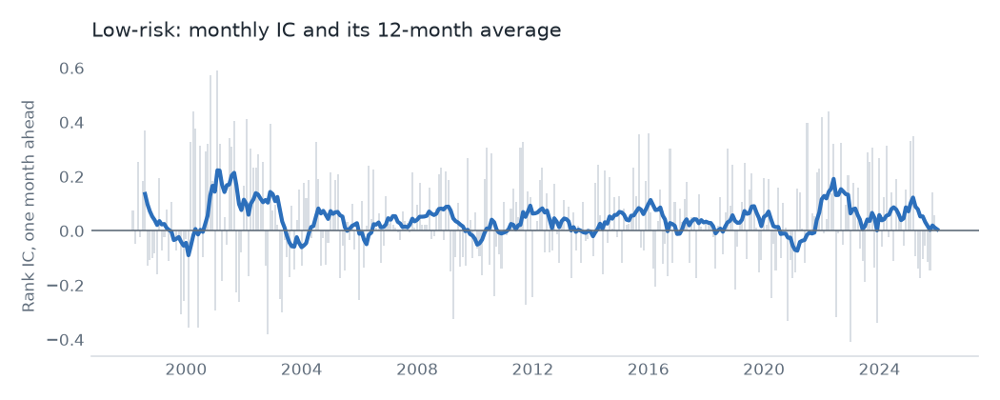
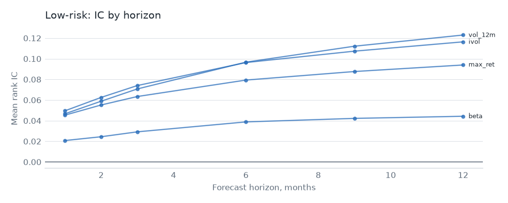

# Low risk

## Hypothesis

Safe stocks earn more than their risk suggests. Investors who can't use leverage overpay for high-beta names, and lottery-seekers overpay for volatile ones. Four measures test it: market beta, idiosyncratic volatility, the largest recent daily return, and 12-month volatility.

## Evidence

Top 3,000, 1998 to 2025, one-month rank IC. The value-weighted decile spread is gross of costs. The last column is OSAP's published series, in sample and then after publication.

| Signal | Mean IC | IC t | Neutralized IC t | VW spread t | OSAP r | OSAP mean per year, before then after |
|---|---|---|---|---|---|---|
| `beta` | 0.021 | 1.9 | 1.8 | -0.6 | 0.86 | 14.9%, 3.3% |
| `ivol` | 0.050 | 5.4 | 7.4 | 0.6 | 0.95 | 11.5%, 2.9% |
| `max_ret` | 0.045 | 5.2 | 7.7 | 0.3 | 0.95 | 10.2%, 1.2% |
| `vol_12m` | 0.047 | 4.1 | 6.0 | 0.1 | 0.92 | 10.1%, -0.8% |

Every signal replicates, so these are the same effects OSAP measures. The picture is sharply split. 3 of 4 clear t = 3.0 on IC, but value-weighted spreads are near zero: `vol_12m` at t 0.1, `ivol` at t 0.6. Avoiding the most volatile small stocks has paid. Holding low-risk large caps against high-risk ones has not.

This is also where publication did the most damage. OSAP's `max_ret` falls from 10.2% to 1.2% a year, and `vol_12m` goes from 10.1% to -0.8%.

As a family, an equal-weight neutralized book has a gross Sharpe of 0.48 and alpha of 9.6% (t 4.6). It has the worst economics of the five. Short-horizon volatility reshuffles fast, so it replaces 57% of its book each month and pays 62.4% a year in costs at $100M. Net Sharpe is -2.37 with no trade cap and -1.35 with one.

The short side matters too. High-volatility small caps are the stocks hardest to borrow, and the flat 5.0% assumed for names outside the top 1,000 is likely too low for many of them. The true cost of this book is probably higher than shown.

## Why it might stop working

- **Most of it may be gone.** The published decay here is the largest of any family, and the figures are already small.
- **The short leg is the return.** Much of the effect comes from shorting stocks that are expensive or impossible to borrow, so the paper return may never have been available.
- **Crowded low-volatility funds.** Index products bought this exposure at scale, and low-risk stocks can become expensive as a group.
- **Leverage constraints can ease.** The theory rests on investors being unable to lever. Anything that relaxes that, such as cheap options or leveraged funds, shrinks the premium.

## Verdict

It's a good filter and a poor book. Excluding the most volatile names is worth doing inside another strategy, but trading this family alone doesn't pay.
