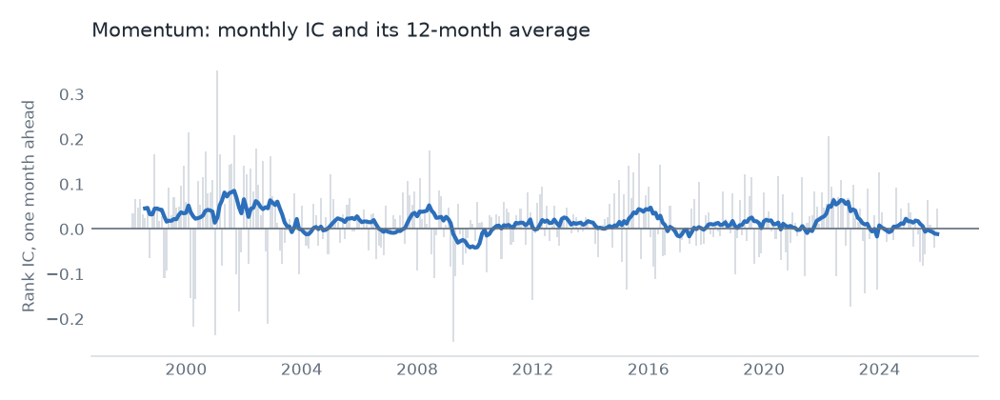
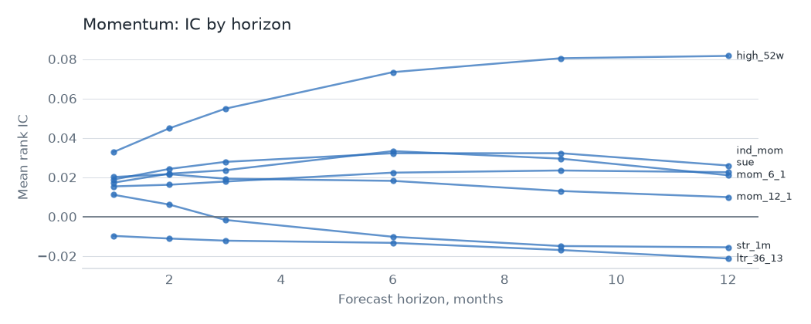

# Momentum

## Hypothesis

Recent winners keep winning for months, because investors underreact to news and then pile in late. Reversal sits at both ends: one-month losers bounce, and three-year losers recover. This family holds both effects, plus earnings surprise and industry momentum.

## Evidence

Top 3,000, 1998 to 2025, one-month rank IC. The value-weighted decile spread is gross of costs. The last column is OSAP's published series, in sample and then after publication.

| Signal | Mean IC | IC t | Neutralized IC t | VW spread t | OSAP r | OSAP mean per year, before then after |
|---|---|---|---|---|---|---|
| `mom_12_1` | 0.020 | 2.6 | 3.0 | 1.4 | 0.92 | 15.3%, 10.8% |
| `mom_6_1` | 0.017 | 2.9 | 2.7 | 1.7 | 0.93 | 11.7%, 13.1% |
| `high_52w` | 0.033 | 3.5 | 1.8 | -0.1 | 0.98 | 5.0%, 3.0% |
| `ind_mom` | 0.019 | 3.1 | none | 1.3 | 0.87 | 3.0%, 4.2% |
| `str_1m` | 0.011 | 2.2 | 4.2 | -0.8 | 0.94 | 35.0%, 18.0% |
| `ltr_36_13` | -0.010 | -1.3 | -4.3 | 0.6 | 0.93 | 8.3%, 5.5% |
| `sue` | 0.015 | 3.9 | 3.2 | 0.8 | 0.69 | 13.9%, 4.9% |

3 of 7 signals clear t = 3.0 on IC. Plain price momentum doesn't: `mom_12_1` sits at t 2.6, a weak result for the best-known anomaly in finance. Earnings surprise and industry momentum hold up better than price alone.

Long-term reversal has the wrong sign on IC in this sample, and it gets stronger in that direction after neutralizing, so it reads as a value effect rather than a separate one.

Industry momentum has no neutralized figure, on purpose. It is one number per industry, so sector dummies span it completely. An early version reported a neutralized t for it, which turned out to be rounding error scaled up to look like a signal.

As a family, an equal-weight neutralized book has a gross Sharpe of 0.73 and alpha of 8.5% (t 4.8). It replaces 48% of its book each month, so it pays 53.8% a year in costs at $100M and its net Sharpe is -2.26, or -1.43 with the trade cap.

## Why it might stop working

- **Crashes.** Momentum shorts the most beaten-down names, which rebound hardest when markets turn. These events are rare and large, so a sample of this length says little about them.
- **Costs.** This is the highest-turnover family after low risk. Its gross return has to clear a cost bill that scales with fund size.
- **Faster information.** If prices absorb news sooner, the underreaction window shrinks. `sue` is the most exposed, since it depends on slow reaction to a public number.
- **Reversal is a liquidity trade.** `str_1m` earns its return for providing liquidity. Its IC is positive, yet its value-weighted spread is flat at t -0.8, so large stocks offer little of it.

## Verdict

There's a real effect, led by earnings surprise, but turnover swamps it. As a stand-alone monthly book it fails under these costs.
