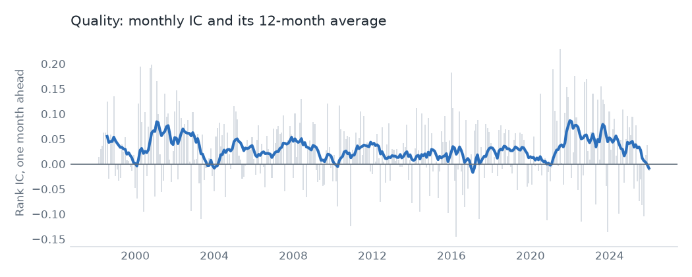
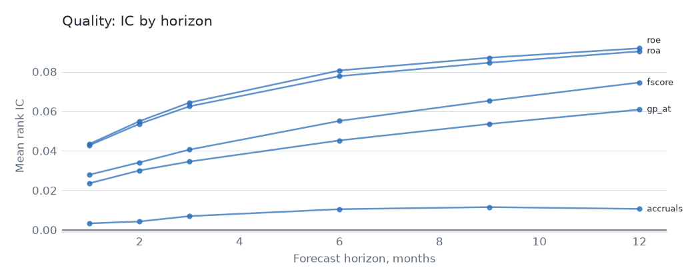

# Quality

## Hypothesis

Profitable, well-run firms are underpriced, because investors don't fully price the persistence of profits. Five measures test it: gross profitability, return on assets, return on equity, the Piotroski score and accruals.

## Evidence

Top 3,000, 1998 to 2025, one-month rank IC. The value-weighted decile spread is gross of costs. The last column is OSAP's published series, in sample and then after publication.

| Signal | Mean IC | IC t | Neutralized IC t | VW spread t | OSAP r | OSAP mean per year, before then after |
|---|---|---|---|---|---|---|
| `gp_at` | 0.024 | 5.1 | 9.2 | 1.9 | 0.72 | 3.6%, 10.7% |
| `roa` | 0.043 | 7.1 | 6.5 | 1.8 | 0.96 | 18.9%, 16.2% |
| `roe` | 0.043 | 6.6 | 5.6 | 1.9 | 0.86 | 3.9%, 4.1% |
| `fscore` | 0.028 | 6.3 | 6.6 | 2.3 | 0.22 | 12.6%, 6.7% |
| `accruals` | 0.003 | 1.0 | -0.4 | -0.3 | 0.39 | 8.2%, 1.1% |

This is the strongest family. 4 of 5 signals clear t = 3.0 on IC, and they survive neutralizing: `gp_at` rises to t 9.2. Gross profitability is the one anomaly here whose published series earned clearly more after publication than before.

Accruals is the exception. Its IC is flat in this sample, and the replication fails. Sharadar has no taxes payable, so that gap is partly data. The published series has also decayed hard. `fscore` fails replication too, at r 0.22, likely because OSAP's version uses different items, though its own IC is strong.

As a family, an equal-weight neutralized book has a gross Sharpe of 0.93 and alpha of 10.4% (t 7.2), and it loads on RMW at 0.68, as it should. It replaces only 23% of its book each month. Net of costs at $100M its Sharpe is still -1.15 with no trade cap and -0.42 with one, the best of the families but below zero.

Rerun after the net failure on published spreads instead of Corwin-Schultz, the Sharpe is -0.83 with no cap and -0.04 with one. That's a follow-up, not a test, and the result is still below zero.

## Why it might stop working

- **It's a popular trade.** Quality has become a product, and flows into it raise prices today at the cost of returns tomorrow. Paying up for quality can look like skill until the multiple falls.
- **Profits mean-revert under competition.** Firms with high margins attract rivals. The signal depends on persistence that could shorten.
- **Accounting changes.** Gross profit and ROA depend on what's capitalized and what's expensed. A rule change could break comparisons over time.
- **Junk rallies.** In sharp recoveries the shorts rebound hardest, so the long-short book loses when risk appetite returns.

## Verdict

This is the family most worth keeping. The effect is strong, it survives neutralizing, and its turnover is low. It's the first place to look for a tradable book, ideally with slower rebalancing and liquid names only.
