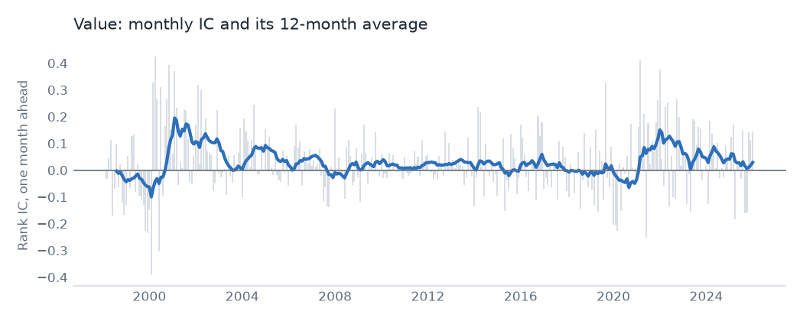
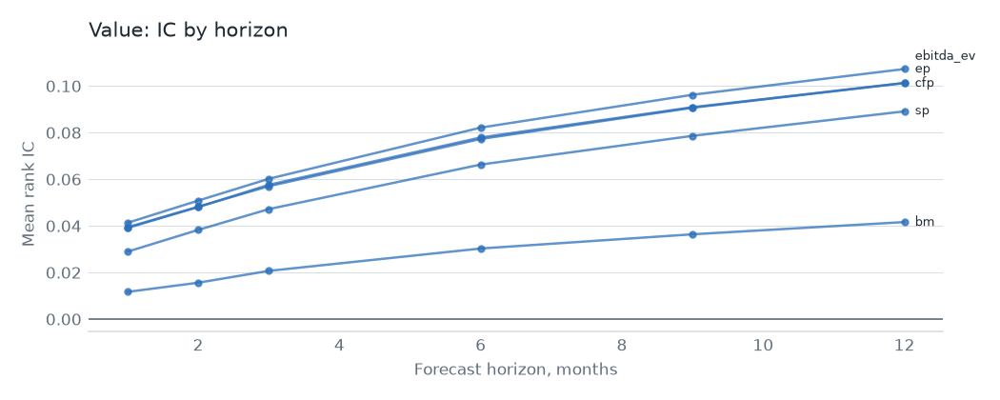

# Value

## Hypothesis

Cheap stocks earn more than expensive ones, either as pay for distress risk or because investors extrapolate bad news too far. Five measures test it: book-to-market, earnings yield, sales yield, cash-flow yield and EBITDA over enterprise value.

## Evidence

Top 3,000, 1998 to 2025, one-month rank IC. The value-weighted decile spread is gross of costs. The last column is OSAP's published series, in sample and then after publication.

| Signal | Mean IC | IC t | Neutralized IC t | VW spread t | OSAP r | OSAP mean per year, before then after |
|---|---|---|---|---|---|---|
| `bm` | 0.012 | 1.4 | 2.5 | -0.6 | 0.91 | 11.5%, 7.1% |
| `ep` | 0.039 | 4.7 | 4.6 | 1.6 | 0.79 | 4.9%, 2.6% |
| `sp` | 0.029 | 3.5 | 4.4 | 1.5 | 0.77 | 8.6%, 9.7% |
| `cfp` | 0.039 | 4.5 | 5.2 | 0.8 | 0.74 | 9.8%, 4.1% |
| `ebitda_ev` | 0.041 | 4.4 | 6.6 | 1.4 | 0.86 | 10.2%, 2.8% |

4 of 5 signals clear t = 3.0 on IC, and none does on the value-weighted spread. The IC gives every stock equal say; the spread gives the largest ones most of it. So the effect lives mostly outside the largest names, and classic book-to-market is the weakest of the five.

Measures built on earnings and cash flow beat book value here, which fits the idea that book equity has lost touch with what firms own.

As a family, an equal-weight neutralized book has a gross Sharpe of 0.61 and FF5 + UMD alpha of 5.6% (t 3.7). Net of costs at $100M the Sharpe is -1.48 with no trade cap and -0.67 with one.

Our value factor is not HML. Its correlation with HML falls from 0.99 under Fama-French's rules to 0.65 on our decile construction and 0.29 once neutralized. Neutralization is the largest single step.

Rerun after the net failure on published spreads instead of Corwin-Schultz, the Sharpe is -1.17 with no cap and -0.34 with one. That's a follow-up, not a test, and the result is still below zero.

## Why it might stop working

- **It already weakened.** All of these signals are long published. Most of OSAP's series earn less after publication than before, and the pooled decline across anomalies is 39%.
- **Book value may keep ageing.** Intangible investment is expensed, so book-to-market misprices firms that spend on research and brands. Nothing here adjusts for that.
- **Long droughts.** Value can trail for a decade. A fund can't always wait, and redemptions at the bottom crystallize the loss.
- **Crowding.** Slow signals are cheap to trade, so they are the first place capital goes.

## Verdict

The cross-sectional signal is real but concentrated away from the largest names, and it doesn't pay for its costs as a stand-alone book under these assumptions.
