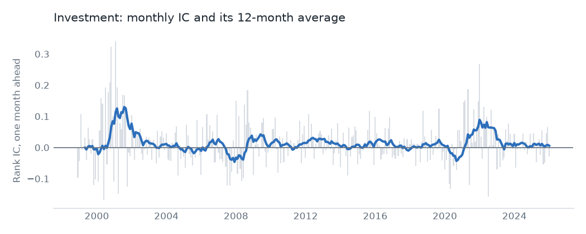
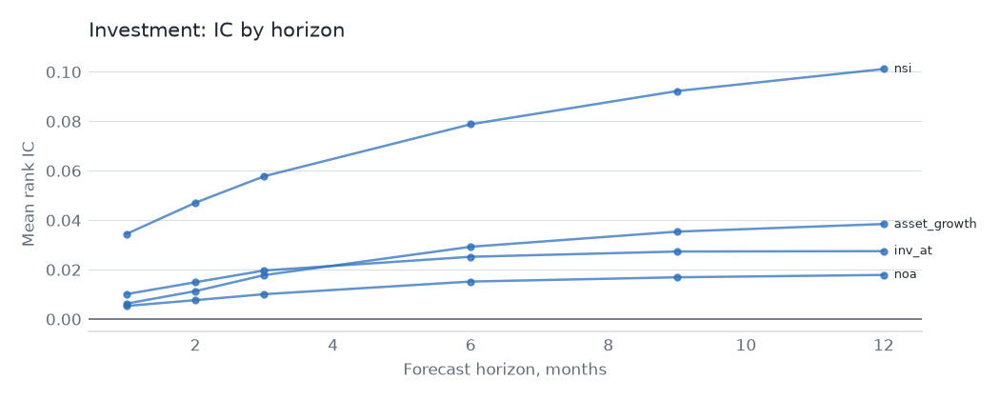

# Investment

## Hypothesis

Firms that grow their assets or issue shares earn less afterwards. Either their cost of capital is low, so more projects look worthwhile, or managers issue stock and build empires when shares are dear. Four measures test it: asset growth, investment in plant and inventory, net operating assets, and net share issuance.

## Evidence

Top {{spec.universe}}, {{spec.start}} to {{spec.end}}, one-month rank IC. The value-weighted decile spread is gross of costs. The last column is OSAP's published series, in sample and then after publication.

| Signal | Mean IC | IC t | Neutralized IC t | VW spread t | OSAP r | OSAP mean per year, before then after |
|---|---|---|---|---|---|---|
| `asset_growth` | {{signal.asset_growth.ic}} | {{signal.asset_growth.ic_t}} | {{signal.asset_growth.ic_t_neutral}} | {{signal.asset_growth.vw_t}} | {{signal.asset_growth.osap}} | {{signal.asset_growth.before}}, {{signal.asset_growth.after}} |
| `inv_at` | {{signal.inv_at.ic}} | {{signal.inv_at.ic_t}} | {{signal.inv_at.ic_t_neutral}} | {{signal.inv_at.vw_t}} | {{signal.inv_at.osap}} | {{signal.inv_at.before}}, {{signal.inv_at.after}} |
| `noa` | {{signal.noa.ic}} | {{signal.noa.ic_t}} | {{signal.noa.ic_t_neutral}} | {{signal.noa.vw_t}} | {{signal.noa.osap}} | {{signal.noa.before}}, {{signal.noa.after}} |
| `nsi` | {{signal.nsi.ic}} | {{signal.nsi.ic_t}} | {{signal.nsi.ic_t_neutral}} | {{signal.nsi.vw_t}} | {{signal.nsi.osap}} | {{signal.nsi.before}}, {{signal.nsi.after}} |

Only {{family.investment.over_hurdle}} of {{family.investment.signals}} signals clears t = {{spec.hurdle}} on IC: net share issuance. Asset growth, investment and net operating assets are weak on their own, and the first and third turn negative after neutralizing. Their published series fell hard after publication.

Replication needed care here. Annual Compustat items reach OSAP's portfolios with a {{spec.fiscal_lag}}-month lag, so our latest-quarter signals don't match them. Using OSAP's timing lifted `asset_growth` to r {{signal.asset_growth.osap}} and `inv_at` to r {{signal.inv_at.osap}}. `noa` stays at r {{signal.noa.osap}}, since Sharadar has no minority interest or deferred charges.

Yet the family book has the highest gross Sharpe of any family, {{family.investment.gross_sharpe}}, with alpha of {{family.investment.gross_alpha}} (t {{family.investment.gross_alpha_t}}). Combining the four at low turnover does better than most of them alone suggest. It loads on CMA at {{family.investment.gross_cma}}, and the factors explain little of it: R-squared is {{family.investment.gross_r2}}. Most of the return isn't the Fama-French investment factor.

Net of costs at {{spec.aum}} the Sharpe is {{family.investment.net_sharpe}} with no trade cap and {{family.investment.capped_sharpe}} with one.

Rerun after the net failure on published spreads instead of Corwin-Schultz, the Sharpe is {{spread.table.family.investment.net_sharpe}} with no cap and {{spread.table.family.investment.capped_sharpe}} with one. That's a follow-up, not a test, and the result is still below zero.

## Why it might stop working

- **Published decay.** Three of these four anomalies have lost most of their published return. Net share issuance is the exception so far, and exceptions have a habit of closing.
- **Buybacks changed the signal.** Issuance now mixes equity pay, buybacks and acquisitions. If the mix keeps shifting, the same number means something different.
- **Interest rates.** Low rates make growth cheap for every firm. A long period of different rates would test whether the effect is about mispricing or about the cost of capital.
- **It may be a combination artefact.** The strong family result rests on combining signals, not on any single one, so it's the result most exposed to selection across these four choices.

## Verdict

Share issuance is the real signal here. The family book is attractive gross, but the strength of the combination deserves more suspicion than a single clean effect would.
