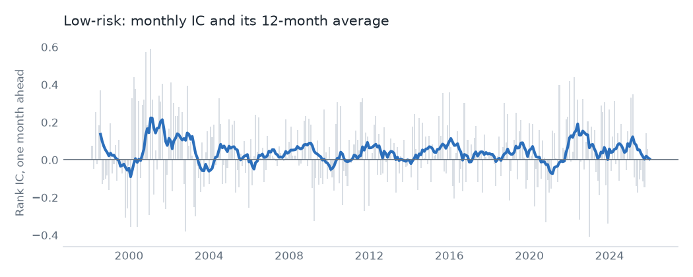
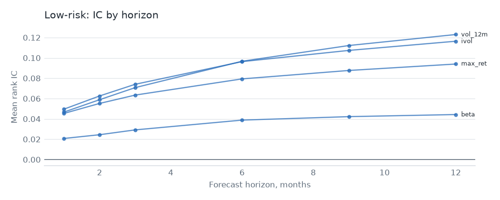

# Low risk

## Hypothesis

Safe stocks earn more than their risk suggests. Investors who can't use leverage overpay for high-beta names, and lottery-seekers overpay for volatile ones. Four measures test it: market beta, idiosyncratic volatility, the largest recent daily return, and 12-month volatility.

## Evidence

Top {{spec.universe}}, {{spec.start}} to {{spec.end}}, one-month rank IC. The value-weighted decile spread is gross of costs. The last column is OSAP's published series, in sample and then after publication.

| Signal | Mean IC | IC t | Neutralized IC t | VW spread t | OSAP r | OSAP mean per year, before then after |
|---|---|---|---|---|---|---|
| `beta` | {{signal.beta.ic}} | {{signal.beta.ic_t}} | {{signal.beta.ic_t_neutral}} | {{signal.beta.vw_t}} | {{signal.beta.osap}} | {{signal.beta.before}}, {{signal.beta.after}} |
| `ivol` | {{signal.ivol.ic}} | {{signal.ivol.ic_t}} | {{signal.ivol.ic_t_neutral}} | {{signal.ivol.vw_t}} | {{signal.ivol.osap}} | {{signal.ivol.before}}, {{signal.ivol.after}} |
| `max_ret` | {{signal.max_ret.ic}} | {{signal.max_ret.ic_t}} | {{signal.max_ret.ic_t_neutral}} | {{signal.max_ret.vw_t}} | {{signal.max_ret.osap}} | {{signal.max_ret.before}}, {{signal.max_ret.after}} |
| `vol_12m` | {{signal.vol_12m.ic}} | {{signal.vol_12m.ic_t}} | {{signal.vol_12m.ic_t_neutral}} | {{signal.vol_12m.vw_t}} | {{signal.vol_12m.osap}} | {{signal.vol_12m.before}}, {{signal.vol_12m.after}} |

Every signal replicates, so these are the same effects OSAP measures. The picture is sharply split. {{family.low_risk.over_hurdle}} of {{family.low_risk.signals}} clear t = {{spec.hurdle}} on IC, but value-weighted spreads are near zero: `vol_12m` at t {{signal.vol_12m.vw_t}}, `ivol` at t {{signal.ivol.vw_t}}. Avoiding the most volatile small stocks has paid. Holding low-risk large caps against high-risk ones has not.

This is also where publication did the most damage. OSAP's `max_ret` falls from {{signal.max_ret.before}} to {{signal.max_ret.after}} a year, and `vol_12m` goes from {{signal.vol_12m.before}} to {{signal.vol_12m.after}}.

As a family, an equal-weight neutralized book has a gross Sharpe of {{family.low_risk.gross_sharpe}} and alpha of {{family.low_risk.gross_alpha}} (t {{family.low_risk.gross_alpha_t}}). It has the worst economics of the five. Short-horizon volatility reshuffles fast, so it replaces {{family.low_risk.turnover}} of its book each month and pays {{family.low_risk.total_cost}} a year in costs at {{spec.aum}}. Net Sharpe is {{family.low_risk.net_sharpe}} with no trade cap and {{family.low_risk.capped_sharpe}} with one.

The short side matters too. High-volatility small caps are the stocks hardest to borrow, and the flat {{spec.borrow_rest}} assumed for names outside the top {{spec.tier_mid}} is likely too low for many of them. The true cost of this book is probably higher than shown.

## Why it might stop working

- **Most of it may be gone.** The published decay here is the largest of any family, and the figures are already small.
- **The short leg is the return.** Much of the effect comes from shorting stocks that are expensive or impossible to borrow, so the paper return may never have been available.
- **Crowded low-volatility funds.** Index products bought this exposure at scale, and low-risk stocks can become expensive as a group.
- **Leverage constraints can ease.** The theory rests on investors being unable to lever. Anything that relaxes that, such as cheap options or leveraged funds, shrinks the premium.

## Verdict

It's a good filter and a poor book. Excluding the most volatile names is worth doing inside another strategy, but trading this family alone doesn't pay.
