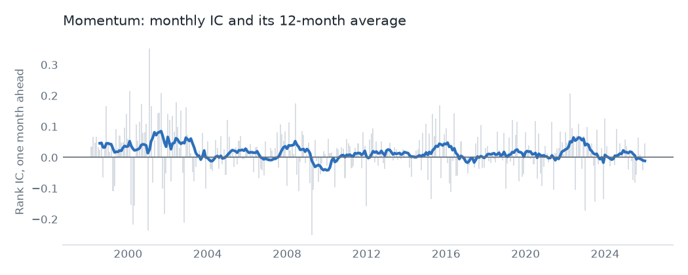
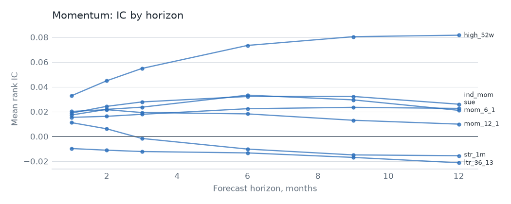

# Momentum

## Hypothesis

Recent winners keep winning for months, because investors underreact to news and then pile in late. Reversal sits at both ends: one-month losers bounce, and three-year losers recover. This family holds both effects, plus earnings surprise and industry momentum.

## Evidence

Top {{spec.universe}}, {{spec.start}} to {{spec.end}}, one-month rank IC. The value-weighted decile spread is gross of costs. The last column is OSAP's published series, in sample and then after publication.

| Signal | Mean IC | IC t | Neutralized IC t | VW spread t | OSAP r | OSAP mean per year, before then after |
|---|---|---|---|---|---|---|
| `mom_12_1` | {{signal.mom_12_1.ic}} | {{signal.mom_12_1.ic_t}} | {{signal.mom_12_1.ic_t_neutral}} | {{signal.mom_12_1.vw_t}} | {{signal.mom_12_1.osap}} | {{signal.mom_12_1.before}}, {{signal.mom_12_1.after}} |
| `mom_6_1` | {{signal.mom_6_1.ic}} | {{signal.mom_6_1.ic_t}} | {{signal.mom_6_1.ic_t_neutral}} | {{signal.mom_6_1.vw_t}} | {{signal.mom_6_1.osap}} | {{signal.mom_6_1.before}}, {{signal.mom_6_1.after}} |
| `high_52w` | {{signal.high_52w.ic}} | {{signal.high_52w.ic_t}} | {{signal.high_52w.ic_t_neutral}} | {{signal.high_52w.vw_t}} | {{signal.high_52w.osap}} | {{signal.high_52w.before}}, {{signal.high_52w.after}} |
| `ind_mom` | {{signal.ind_mom.ic}} | {{signal.ind_mom.ic_t}} | none | {{signal.ind_mom.vw_t}} | {{signal.ind_mom.osap}} | {{signal.ind_mom.before}}, {{signal.ind_mom.after}} |
| `str_1m` | {{signal.str_1m.ic}} | {{signal.str_1m.ic_t}} | {{signal.str_1m.ic_t_neutral}} | {{signal.str_1m.vw_t}} | {{signal.str_1m.osap}} | {{signal.str_1m.before}}, {{signal.str_1m.after}} |
| `ltr_36_13` | {{signal.ltr_36_13.ic}} | {{signal.ltr_36_13.ic_t}} | {{signal.ltr_36_13.ic_t_neutral}} | {{signal.ltr_36_13.vw_t}} | {{signal.ltr_36_13.osap}} | {{signal.ltr_36_13.before}}, {{signal.ltr_36_13.after}} |
| `sue` | {{signal.sue.ic}} | {{signal.sue.ic_t}} | {{signal.sue.ic_t_neutral}} | {{signal.sue.vw_t}} | {{signal.sue.osap}} | {{signal.sue.before}}, {{signal.sue.after}} |

{{family.momentum.over_hurdle}} of {{family.momentum.signals}} signals clear t = {{spec.hurdle}} on IC. Plain price momentum doesn't: `mom_12_1` sits at t {{signal.mom_12_1.ic_t}}, a weak result for the best-known anomaly in finance. Earnings surprise and industry momentum hold up better than price alone.

Long-term reversal has the wrong sign on IC in this sample, and it gets stronger in that direction after neutralizing, so it reads as a value effect rather than a separate one.

Industry momentum has no neutralized figure, on purpose. It is one number per industry, so sector dummies span it completely. An early version reported a neutralized t for it, which turned out to be rounding error scaled up to look like a signal.

As a family, an equal-weight neutralized book has a gross Sharpe of {{family.momentum.gross_sharpe}} and alpha of {{family.momentum.gross_alpha}} (t {{family.momentum.gross_alpha_t}}). It replaces {{family.momentum.turnover}} of its book each month, so it pays {{family.momentum.total_cost}} a year in costs at {{spec.aum}} and its net Sharpe is {{family.momentum.net_sharpe}}, or {{family.momentum.capped_sharpe}} with the trade cap.

Rerun after the net failure on published spreads instead of Corwin-Schultz, the Sharpe is {{spread.table.family.momentum.net_sharpe}} with no cap and {{spread.table.family.momentum.capped_sharpe}} with one. That's a follow-up, not a test, and the result is still below zero.

## Why it might stop working

- **Crashes.** Momentum shorts the most beaten-down names, which rebound hardest when markets turn. These events are rare and large, so a sample of this length says little about them.
- **Costs.** This is the highest-turnover family after low risk. Its gross return has to clear a cost bill that scales with fund size.
- **Faster information.** If prices absorb news sooner, the underreaction window shrinks. `sue` is the most exposed, since it depends on slow reaction to a public number.
- **Reversal is a liquidity trade.** `str_1m` earns its return for providing liquidity. Its IC is positive, yet its value-weighted spread is flat at t {{signal.str_1m.vw_t}}, so large stocks offer little of it.

## Verdict

There's a real effect, led by earnings surprise, but turnover swamps it. As a stand-alone monthly book it fails under these costs.
